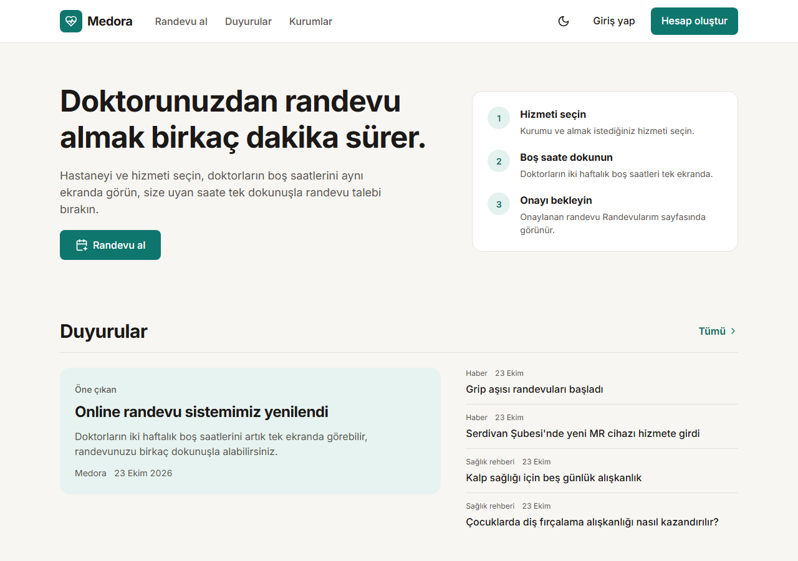
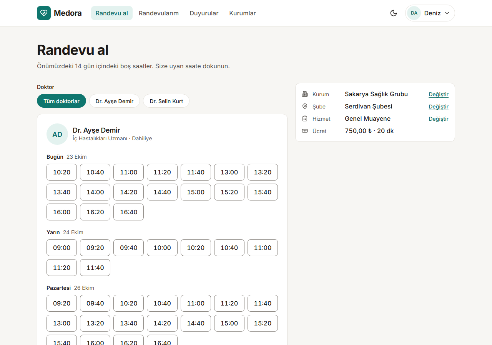
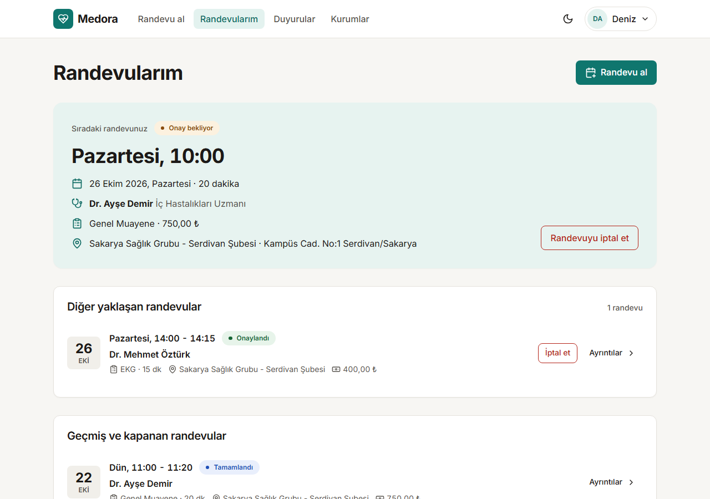
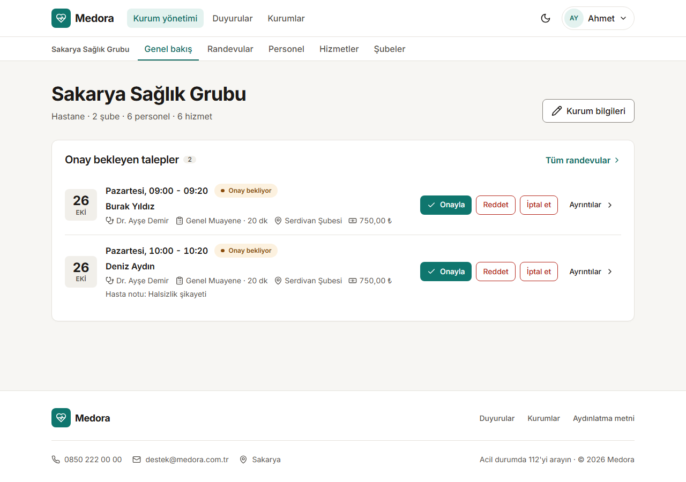
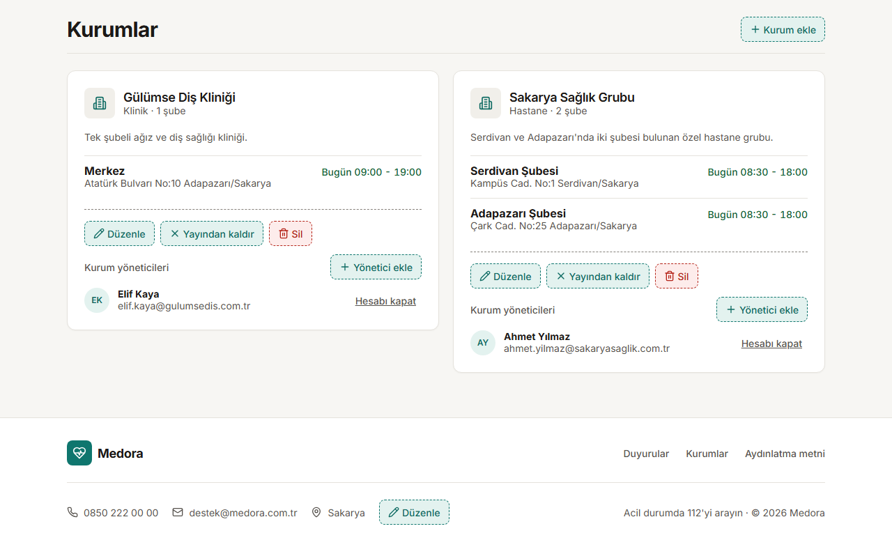

# Medora: Hastane / Klinik Randevu Sistemi

Nesneye Dayalı Programlama dersi proje ödevi, **Seçenek A**. Tek şubeli klinikleri ve çok şubeli hastane
gruplarını destekleyen, dört rollü bir online randevu sistemi.

| | |
|---|---|
| Öğrenci | Ali Kerem Kol |
| Numara | Y265012017 |
| Ders | Nesneye Dayalı Programlama Dilleri |
| Dönem | 2026-2027 Güz |
| Öğretim üyesi | Dr. Öğr. Üyesi Can Yüzkollar |

**Teknolojiler:** Java 17 · Spring Boot 3.4 · Spring MVC + Thymeleaf · Spring Data JPA (Hibernate) ·
Spring Security · H2 · JUnit 5



## İçindekiler

1. [Çalıştırma](#çalıştırma)
2. [Ödev gereksinimleri ve karşılıkları](#ödev-gereksinimleri-ve-karşılıkları)
3. [Nesneye dayalı programlama ilkeleri](#nesneye-dayalı-programlama-ilkeleri)
4. [Tasarım desenleri ve SOLID](#tasarım-desenleri-ve-solid)
5. [Roller ve yapabildikleri](#roller-ve-yapabildikleri)
6. [Ekranlar](#ekranlar)
7. [Güvenlik](#güvenlik)
8. [Testler](#testler)
9. [Proje yapısı](#proje-yapısı)

Sınıf, durum ve sıra diyagramları ayrı bir belgede: **[docs/TASARIM.md](docs/TASARIM.md)**

---

## Çalıştırma

Bilgisayarda yalnızca **Java 17 veya üstü** kurulu olması yeterlidir; Maven, proje içindeki wrapper ile
kendiliğinden indirilir.

```bash
# Windows
mvnw.cmd spring-boot:run

# Linux / macOS
./mvnw spring-boot:run
```

Tarayıcıda **http://localhost:8080** adresini açın. Testleri çalıştırmak için `mvnw.cmd test`.

Veritabanı bellek içi H2'dir; uygulama her açılışta aşağıdaki örnek verilerle yeniden kurulur.

### Örnek hesaplar

Kullanıcı adı yoktur: **hastalar T.C. Kimlik No**, personel ve yöneticiler **kurumsal e-posta** ile giriş yapar.
Tüm örnek hesapların şifresi **`Medora2026`**.

| Rol | Giriş kimliği | Not |
|---|---|---|
| Hasta | `62601815964` (Deniz Aydın) | Yaklaşan ve geçmiş randevuları var |
| Hasta | `18301661332` (Burak Yıldız) | |
| Doktor | `ayse.demir@sakaryasaglik.com.tr` | İç Hastalıkları, Serdivan |
| Doktor | `selin.kurt@sakaryasaglik.com.tr` | İç Hastalıkları, Serdivan (aynı hizmeti veren ikinci doktor) |
| Doktor | `mehmet.ozturk@sakaryasaglik.com.tr` | Kardiyoloji, Serdivan |
| Doktor | `zeynep.arslan@sakaryasaglik.com.tr` | İç Hastalıkları, Adapazarı |
| Doktor | `can.sahin@gulumsedis.com.tr` | Diş kliniği |
| Sağlık Personeli | `ali.celik@sakaryasaglik.com.tr` | Radyoloji teknisyeni |
| Sağlık Personeli | `fatma.koc@sakaryasaglik.com.tr` | Laborant |
| Kurum Yöneticisi | `ahmet.yilmaz@sakaryasaglik.com.tr` | Sakarya Sağlık Grubu (2 şube) |
| Kurum Yöneticisi | `elif.kaya@gulumsedis.com.tr` | Gülümse Diş Kliniği (tek şube) |
| Sistem Yöneticisi | `admin@medora.com.tr` | Kurumları ve kurum yöneticilerini yönetir |

Yeni hasta hesabı **Hesap oluştur** sayfasından açılır; geçerli bir T.C. Kimlik No gerekir
(denemek için `28609139020`).

---

## Ödev gereksinimleri ve karşılıkları

Ödev belgesindeki her madde, uygulamadaki karşılığı ve onu doğrulayan test:

| Ödev belgesindeki madde | Uygulamada | Kod | Test |
|---|---|---|---|
| Hem tek klinik/hastane hem çok şubeli kuruluşları desteklemeli | `Kurum` bir ya da çok `Sube`'ye sahiptir. Tek şubeli kurumda hasta şube seçmeden ilerler | [Kurum](src/main/java/com/klinik/randevu/model/kurum/Kurum.java), [Sube](src/main/java/com/klinik/randevu/model/kurum/Sube.java) | `PersonelVeKurumTest`, `SubeBolumHizmetTest` |
| Hastaneler/klinikler **yetki çerçevesinde** tanımlanabilecek | Kurumu yalnızca sistem yöneticisi tanımlar, düzenler, yayından kaldırır, siler. Kurum yöneticisi yalnızca kendi kurumunu yönetir | [KurumServisi](src/main/java/com/klinik/randevu/servis/KurumServisi.java), `Kullanici.kurumTanimlayabilirMi()`, `kurumuYonetebilirMi()` | `KurumYonetimiTest`, `GuvenlikTest` |
| Her kurumun **çalışma saatleri ve bölümleri** tanımlanabilecek | Şube bazında gün gün açılış/kapanış saati; bölüm ekleme, düzenleme, kaldırma | [Sube](src/main/java/com/klinik/randevu/model/kurum/Sube.java), [CalismaSaati](src/main/java/com/klinik/randevu/model/kurum/CalismaSaati.java), [Bolum](src/main/java/com/klinik/randevu/model/kurum/Bolum.java) | `AlanModeliTest`, `SubeBolumHizmetTest` |
| Sağlık hizmetleri, **süresi ve ücreti** detaylı tanımlanabilecek | `Hizmet`: ad, tür (genel muayene, radyoloji, laboratuvar...), süre, ücret, açıklama, randevuya açık/kapalı | [Hizmet](src/main/java/com/klinik/randevu/model/kurum/Hizmet.java) | `AlanModeliTest`, `SubeBolumHizmetTest` |
| **Doktor ve sağlık personeli** sisteme kaydedilebilecek | İkisi de soyut `Calisan`'dan türer; yönetici ekler, düzenler, pasifleştirir | [Doktor](src/main/java/com/klinik/randevu/model/kullanici/Doktor.java), [SaglikPersoneli](src/main/java/com/klinik/randevu/model/kullanici/SaglikPersoneli.java), [CalisanTipi](src/main/java/com/klinik/randevu/servis/CalisanTipi.java) | `PersonelVeKurumTest` |
| Her doktorun **uzmanlık alanı ve sunduğu hizmetler** | Doktorda uzmanlık, sağlık personelinde görev; yönetici çalışana kurumun hizmetlerini atar | `Calisan.hizmetleriAyarla(...)`, `hizmetVerebilirMi(...)` | `RandevuServisiTest` |
| **Uygunluk zaman dilimleri**; hasta yalnızca bu aralıklara randevu alabilecek | Haftalık tekrar eden `UygunlukDilimi`; çakışan dilim eklenemez. `UygunlukKurali` dilim dışını reddeder, takvim yalnızca uygun saatleri gösterir | [UygunlukDilimi](src/main/java/com/klinik/randevu/model/kullanici/UygunlukDilimi.java), [UygunlukKurali](src/main/java/com/klinik/randevu/servis/kural/UygunlukKurali.java) | `RandevuServisiTest` |
| Kullanıcı **uygun çalışan ve işlem seçerek** randevu oluşturabilecek | Kurum → şube → hizmet → doktor seçilir; doktorların 14 günlük boş saatleri kutucuk olarak gösterilir | [HastaController](src/main/java/com/klinik/randevu/web/HastaController.java), [RandevuServisi](src/main/java/com/klinik/randevu/servis/RandevuServisi.java) | `SubeBolumHizmetTest`, `RandevuServisiTest` |
| Randevu oluşturulurken **çakışma kontrolü** | Çalışan ve hasta için ayrı çakışma kuralı. Eşzamanlı talepler için satır kilidi: aynı saate gelen iki talepten yalnızca biri kabul edilir | [CalisanCakismaKurali](src/main/java/com/klinik/randevu/servis/kural/CalisanCakismaKurali.java), [HastaCakismaKurali](src/main/java/com/klinik/randevu/servis/kural/HastaCakismaKurali.java) | `RandevuServisiTest`, `EszamanliRandevuTest` |
| Randevu detayları (**işlem, süre, ücret, çalışan, tarih/saat**) kaydedilecek | `Randevu` hizmet, çalışan, şube, başlangıç/bitiş, süre ve ücreti saklar. Süre ve ücret kayıt anındaki değerdir; hizmetin ücreti sonradan değişse de eski randevu etkilenmez | [Randevu](src/main/java/com/klinik/randevu/model/randevu/Randevu.java) | `RandevuServisiTest` |
| Randevu için **onay mekanizması** | Talep `BEKLEMEDE` başlar; doktor ya da kurum yöneticisi onaylar veya reddeder. Her geçiş kim, ne zaman, neden bilgisiyle saklanır | [RandevuDurumu](src/main/java/com/klinik/randevu/model/randevu/RandevuDurumu.java), [RandevuHareketi](src/main/java/com/klinik/randevu/model/randevu/RandevuHareketi.java) | `RandevuDurumuTest`, `RandevuYasamDongusuTest` |
| **En az üç rol**: Hasta, Doktor/Sağlık Personeli, Hastane/Klinik Yöneticisi | Dört rol: bu üçü ve kurumları tanımlayan Sistem Yöneticisi | [Kullanici](src/main/java/com/klinik/randevu/model/kullanici/Kullanici.java) ve alt sınıfları | `GuvenlikTest`, `NdpIlkeleriTest` |
| NDP ilkeleri (sınıf yapısı, kalıtım, çok biçimlilik, kapsülleme vb.) | Aşağıdaki bölüm ve [docs/TASARIM.md](docs/TASARIM.md) | | `NdpIlkeleriTest` |

---

## Nesneye dayalı programlama ilkeleri

| İlke | Koddaki örneği | Ne işe yarıyor |
|---|---|---|
| **Sınıf ve nesne** | Alan modeli: [model](src/main/java/com/klinik/randevu/model) paketi (`Kurum`, `Sube`, `Hizmet`, `Randevu`...) | Her kavram verisini ve kurallarını bir arada taşır. `Randevu` kendi durumunu, `Sube` açık olup olmadığını bilir |
| **Soyutlama** | Soyut sınıflar: [TemelVarlik](src/main/java/com/klinik/randevu/model/TemelVarlik.java), [Kullanici](src/main/java/com/klinik/randevu/model/kullanici/Kullanici.java), [Calisan](src/main/java/com/klinik/randevu/model/kullanici/Calisan.java). Arayüzler: [RandevuKurali](src/main/java/com/klinik/randevu/servis/kural/RandevuKurali.java), [DolulukBilgisi](src/main/java/com/klinik/randevu/servis/kural/DolulukBilgisi.java) | `Kullanici` örneği oluşturulamaz, yalnızca somut türleri. `getRol()`, `getPanelYolu()`, `getUnvan()` soyut metotlardır |
| **Kalıtım** | `TemelVarlik` ← tüm varlıklar · `Kullanici` ← `Hasta`, `Calisan`, `Yonetici`, `SistemYoneticisi` · `Calisan` ← `Doktor`, `SaglikPersoneli` · `IsKuraliIhlali` ← `KayitBulunamadiHatasi`, `YetkisizIslemHatasi` | Kimlik ve eşitlik kuralı tek yerde yazılır. Veritabanında tek tablo kalıtımı (`@Inheritance(SINGLE_TABLE)`) kullanılır |
| **Çok biçimlilik (ezme)** | `getPanelYolu()`, `getGorunenAd()` ("Dr." ön eki), `getUnvan()`, `randevuyuYonetebilirMi()`, `kurumTanimlayabilirMi()`, `getHesapMenusu()`, `getCalismaSekmeleri()`, `getProfilBilgileri()` | Servisler ve sayfalar kullanıcının türünü hiç sormaz: `if (rol == ...)` yoktur. Menü, profil ve yetki kararlarını nesnenin kendisi verir. 7 kural sınıfı aynı `dogrula(...)` çağrısıyla çalışır |
| **Çok biçimlilik (aşırı yükleme)** | `Randevu.onayla(yapan)` / `onayla(yapan, zaman)`, `tamamla(...)` ikilisi, `KurumServisi.hizmetGuncelle(...)` iki imza | Aynı işlem, farklı parametrelerle: ekrandan gelen işlem "şimdi" ile, örnek veri ve testler geçmiş tarihli işlem için zaman parametresiyle çağırır |
| **Kapsülleme** | Tüm alanlar `private`; kimliğin `setId`'si yok. Durum yalnızca anlamlı metotlarla değişir (`randevu.onayla()`, `reddet()`, `iptalEt()`) ve geçersiz geçiş reddedilir. Koleksiyonlar değiştirilemez görünüm olarak verilir. `Sube`, `Bolum`, `Hizmet` yapıcıları paket erişimlidir | Nesne her zaman geçerli durumda kalır: negatif ücretli hizmet, kapanıştan sonra açılan şube, çakışan uygunluk dilimi oluşturulamaz |
| **Bileşim / birleştirme** | `Kurum` *-- `Sube` *-- `Bolum` (bütünle birlikte silinir) · `Calisan` o-- `Hizmet` (bağımsız yaşar) | [docs/TASARIM.md](docs/TASARIM.md) sınıf diyagramında gösterildi |
| **Object sözleşmesi** | `TemelVarlik.equals/hashCode/toString`; `Randevu.toString()` ezer | Aynı türden ve aynı kimlikli iki nesne eşittir; kaydedilen nesne `HashSet` içinde kaybolmaz |
| **Değer nesneleri** | `record`: `RandevuTalebi`, `MenuBaglantisi`, `ProfilBilgisi`, `GunlukMusaitlik`; [TcKimlikNo](src/main/java/com/klinik/randevu/model/kullanici/TcKimlikNo.java) | Değiştirilemez veri taşıyıcıları |
| **Enum ile davranış** | `RandevuDurumu.gecebilir(...)`, `CalisanTipi` sabitlerinin her biri kendi `olustur(...)` metodunu ezer | Durum makinesi ve fabrika enum içinde |
| **Genel türler (generics)** | `HastaController.sec(List<T>, Long, Function<T, Long>)`, `List<RandevuKurali>` | Kurum, şube, hizmet ve doktor seçimi tek metotla |
| **İstisna yönetimi** | `IsKuraliIhlali` hiyerarşisi + tek bir `@ControllerAdvice` ([HataYakalayici](src/main/java/com/klinik/randevu/web/HataYakalayici.java)) | Kural ihlalinde kullanıcı geldiği sayfaya, anlaşılır bir mesajla döner |

Bu ilkelerin çoğu [NdpIlkeleriTest](src/test/java/com/klinik/randevu/model/NdpIlkeleriTest.java) ile otomatik
olarak sınanır (çok biçimli menü ve profil, eşitlik sözleşmesi, kimliğin değiştirilemezliği).

## Tasarım desenleri ve SOLID

| Desen | Nerede |
|---|---|
| **Strateji** | `RandevuKurali` arayüzü ve 7 uygulaması; `DolulukBilgisi` arayüzü ve 2 uygulaması (veritabanından / bellekten) |
| **Şablon metot** | `Kullanici.calismaSekmesiMi(...)` `final`'dır ve alt sınıfların ezdiği `getCalismaSekmeleri()`'ni kullanır; `randevuyuGorebilirMi` varsayılan olarak `randevuyuYonetebilirMi`'ye dayanır |
| **Fabrika metodu** | `Randevu.olustur(...)`, `Randevu.gecmisKaydiAktar(...)`; `CalisanTipi.DOKTOR.olustur(...)` doğru alt sınıfı üretir |
| **Durum makinesi** | `RandevuDurumu.gecebilir(...)` izin verilen geçişleri tanımlar |
| **Repository** | `repository` paketindeki Spring Data JPA arayüzleri |
| **MVC** | `web` (Controller) + `templates` (View) + `model` |
| **Bağımlılık enjeksiyonu** | Tüm servisler yapıcı (constructor) enjeksiyonu kullanır |

- **S**: Her kural ayrı sınıf; kurum, personel, randevu, içerik ve hesap işlemleri ayrı servislerde.
- **O**: Yeni randevu kuralı mevcut kodu değiştirmeden eklenir (son eklenen `KurumYayindaKurali` buna örnektir).
- **L**: `Doktor` ve `SaglikPersoneli`, `Calisan` beklenen her yerde kullanılır; `Hasta`, `Yonetici`... `Kullanici` beklenen her yerde.
- **I**: `RandevuKurali` tek metotlu, `DolulukBilgisi` iki metotlu dar arayüzlerdir.
- **D**: `RandevuServisi` somut kurallara değil `RandevuKurali` soyutlamasına bağımlıdır.

---

## Roller ve yapabildikleri

| Rol | Yapabildikleri |
|---|---|
| **Hasta** | Hesap oluşturur; kurum, şube, hizmet ve doktor seçip boş saate randevu alır; randevularını ve durum geçmişini görür; başlamamış randevusunu iptal eder |
| **Doktor / Sağlık personeli** | Kendine gelen talepleri onaylar, reddeder, iptal eder; tamamlandı / gelmedi işaretler; haftalık çalışma saatlerini (uygunluk dilimleri) düzenler |
| **Kurum yöneticisi** | Kendi kurumunun bilgilerini, şubelerini, çalışma saatlerini, bölümlerini, hizmetlerini ve personelini yönetir; kurumun tüm randevularını görür ve onaylar; kurum adına duyuru yazar |
| **Sistem yöneticisi** | Kurum ekler, düzenler, yayından kaldırır, siler; kurum yöneticisi atar, hesabını kapatır/açar; ana sayfa metinlerini, iletişim bilgilerini ve duyuruları yönetir. Ayrı bir panel yoktur: herkesin gördüğü sayfalarda yalnızca ona görünen düzenleme düğmeleriyle çalışır |

Randevu yaşam döngüsü: talep `BEKLEMEDE` başlar. Saati gelip hâlâ onaylanmamışsa sistem `ZAMAN_ASIMI` yapar;
onaylı randevu bitişinden 2 saat sonra kendiliğinden `TAMAMLANDI` olur (`RandevuZamanlayici`, her dakika).
Ayrıntılı durum diyagramı: [docs/TASARIM.md](docs/TASARIM.md#3-randevu-durumları-durum-diyagramı).

## Ekranlar

| Randevu alma: hizmet ve doktor seçimi, boş saatler | Hastanın randevuları |
|---|---|
|  |  |

| Kurum yöneticisi: onay bekleyen talepler | Sistem yöneticisi: kurum yönetimi ana sayfada |
|---|---|
|  |  |

Arayüz açık ve koyu temalıdır; tema düğmesi her sayfanın üst menüsündedir. Mobil öncelikli tasarlanmıştır,
renk kontrastı WCAG 2.2 AA eşiklerini sağlar ve arayüzde emoji yerine SVG ikon seti kullanılır.

---

## Güvenlik

| Katman | Nasıl korunuyor |
|---|---|
| Oturum | Spring Security form girişi, BCrypt şifre özeti, oturum sabitleme koruması |
| Sayfa | Her rol yalnızca kendi adres ağacına girer: `/hasta/**`, `/calisan/**`, `/yonetici/**`, `/admin/**`; yanlış rol 403 alır |
| Kayıt | Adreste kimlik olan her işlemde nesnenin kendisine sorulur (`randevuyuYonetebilirMi`, `kurumuYonetebilirMi`...). Hasta başkasının randevusunu iptal edemez, yönetici başka kurumun şubesini düzenleyemez |
| Form | Tüm POST isteklerinde CSRF jetonu zorunludur |
| Eşzamanlılık | Randevu kaydında çalışan ve hasta satırı kilitlenir; randevu güncellemelerinde `@Version` ile iyimser kilit |
| Pasif hesap | Pasifleştirilen personel ya da kapatılan yönetici giriş yapamaz; açık oturumu bir sonraki istekte kapanır |
| Kaba kuvvet | Aynı hesaba 15 dakikada 5, aynı cihazdan 20 hatalı giriş 15 dakikalık kilit getirir; mesajlar hesabın var olup olmadığını ele vermez |
| Kişisel veri | T.C. Kimlik No ekranlarda maskelenir (`62*******64`); kayıt formu aydınlatma metnine bağlanır |
| Tarayıcı | Content-Security-Policy (yalnızca kendi betikleri), `X-Frame-Options: DENY`; içerik düz metin saklanır, HTML enjekte edilemez |

## Testler

`mvnw.cmd test` ile **127 test** çalışır:

| Test sınıfı | Sayı | Neyi sınar |
|---|---|---|
| `NdpIlkeleriTest` | 10 | Çok biçimli menü/profil/yetki, eşitlik sözleşmesi, kapsülleme |
| `AlanModeliTest` | 8 | Şube saatleri, hizmet doğrulaması, uygunluk dilimleri (veritabanısız) |
| `RandevuDurumuTest` | 3 | İzin verilen ve verilmeyen durum geçişleri |
| `TcKimlikNoTest` | 4 | T.C. Kimlik No algoritması ve maskeleme |
| `RandevuServisiTest` | 11 | Kurallar, çakışma, uygunluk, takvim |
| `EszamanliRandevuTest` | 2 | Aynı anda gelen iki talepten yalnızca birinin kabulü |
| `RandevuYasamDongusuTest` | 10 | Zaman aşımı, otomatik tamamlama, gelmedi, durum geçmişi |
| `KullaniciServisiTest` | 7 | Kayıt, iletişim bilgisi, şifre değişikliği |
| `GuvenlikTest` | 11 | Rol ve kayıt düzeyinde erişim denetimi |
| `KotuyeKullanimTest` | 7 | Kaba kuvvet ve hesap taraması koruması |
| `KurumYonetimiTest` | 9 | Kurum düzenleme, yayından kaldırma, silme, yönetici hesabı |
| `SubeBolumHizmetTest` | 12 | Şube, bölüm, hizmet düzenleme/kaldırma, doktor seçimi, hata sonrası doğru sayfaya dönüş |
| `PersonelVeKurumTest` | 11 | Personel düzenleme/pasifleştirme, kurum oluşturma |
| `IcerikTest` | 11 | Ana sayfa, duyurular ve içerik yetkileri |
| `SayfaRenderTest` | 6 | Her rolün her sayfasının hatasız çizilmesi |
| `DenemeSinirlayiciTest` | 5 | Zamana bağlı deneme sınırı |

## Proje yapısı

```
src/main/java/com/klinik/randevu
├── model
│   ├── TemelVarlik      Tüm varlıkların soyut üst sınıfı (kimlik, equals/hashCode/toString)
│   ├── kullanici        Kullanici ← Hasta, Calisan ← Doktor/SaglikPersoneli, Yonetici, SistemYoneticisi;
│   │                    UygunlukDilimi, TcKimlikNo, MenuBaglantisi, ProfilBilgisi
│   ├── kurum            Kurum, Sube, Bolum, CalismaSaati, Hizmet (+ enum'lar)
│   ├── randevu          Randevu, RandevuHareketi, RandevuDurumu
│   └── icerik           Duyuru, SiteAyarlari
├── servis               KurumServisi, PersonelServisi, RandevuServisi, KullaniciServisi, IcerikServisi,
│   │                    RandevuZamanlayici
│   └── kural            RandevuKurali + 7 kural, DolulukBilgisi + 2 uygulama, RandevuTalebi
├── repository           Spring Data JPA arayüzleri
├── guvenlik             Spring Security yapılandırması, giriş kilidi
├── web                  Controller'lar, form nesneleri, hata yakalayıcı
├── veri                 Örnek veri yükleyici
├── yardimci             Tarih biçimlendirme
└── hata                 İş kuralı istisnaları
src/main/resources/templates   Thymeleaf sayfaları
src/main/resources/static      Tema (tema.css), bileşen stilleri, ikonlar, JavaScript
src/test/java                  Birim, entegrasyon, güvenlik ve sayfa testleri
docs/TASARIM.md                Sınıf, strateji, durum ve sıra diyagramları
```
