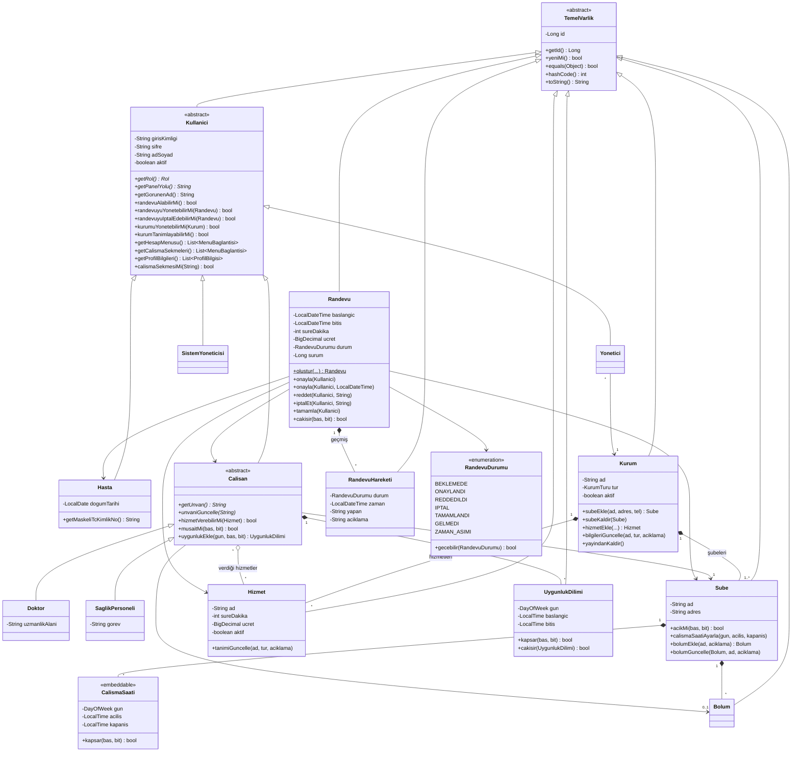
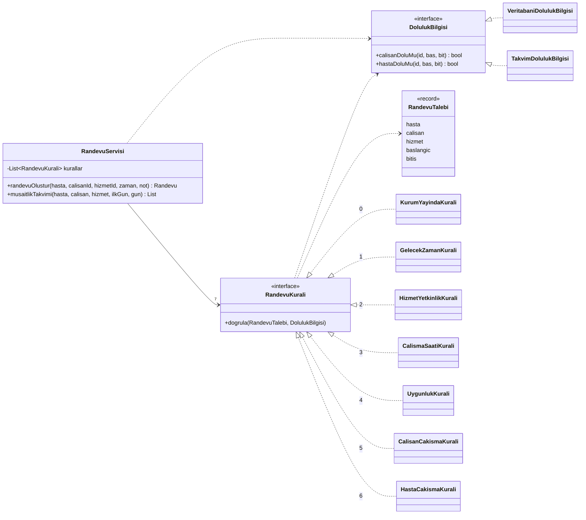
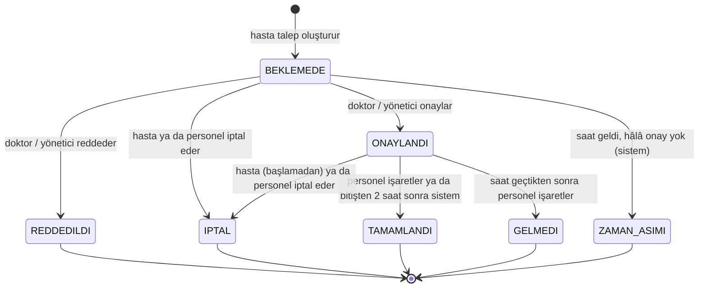
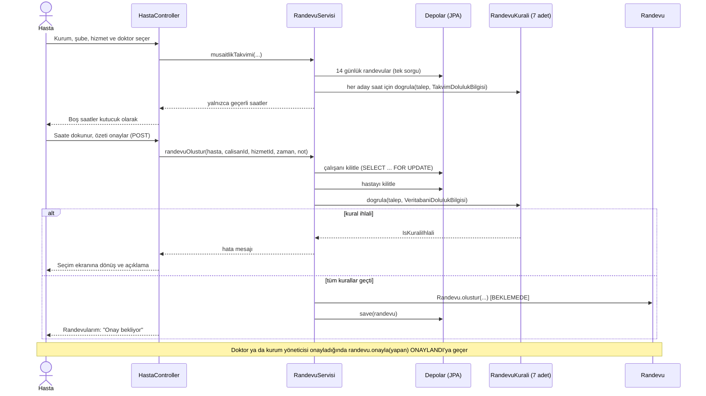
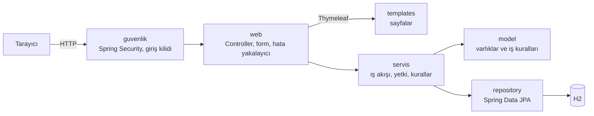

# Tasarım belgesi

Bu belge sistemin nesne modelini dört diyagramla anlatır. Diyagramlar [Mermaid](https://mermaid.js.org)
ile yazılmıştır; GitHub bu dosyayı açtığınızda çizer.

1. [Alan modeli: sınıf diyagramı](#1-alan-modeli-sınıf-diyagramı)
2. [Randevu kuralları: strateji deseni](#2-randevu-kuralları-strateji-deseni)
3. [Randevu durumları: durum diyagramı](#3-randevu-durumları-durum-diyagramı)
4. [Randevu alma: sıra diyagramı](#4-randevu-alma-sıra-diyagramı)
5. [Katmanlar](#5-katmanlar)

---

## 1. Alan modeli: sınıf diyagramı

Tüm varlıklar kimliği ve eşitlik kuralını `TemelVarlik` soyut sınıfından alır. Kullanıcı ağacında
yetki soruları (`randevuyuYonetebilirMi`, `kurumTanimlayabilirMi`...) ve arayüzün ihtiyaç duyduğu
bilgiler (`getHesapMenusu`, `getProfilBilgileri`...) üst sınıfta tanımlanır, her alt sınıf kendine göre ezer.

**Okuma notları**

- `*--` (bileşim): parça bütün olmadan yaşayamaz. Şube, kurum silinince silinir; yapıcısı paket erişimlidir,
  yalnızca `kurum.subeEkle(...)` ile oluşturulur.
- `o--` (birleştirme): çalışan ile hizmet birbirinden bağımsız yaşar; çalışan pasifleşse de hizmet kalır.
- Randevu, ücret ve süreyi oluşturulduğu anki değerleriyle **kopyalar**. Hizmetin ücreti sonradan değişse de
  eski randevu etkilenmez.
- `onayla(Kullanici)` ve `onayla(Kullanici, LocalDateTime)` **aşırı yüklemedir** (derleme zamanı çok biçimliliği).
  `getUnvan()` gibi ezilen metotlar ise çalışma zamanı çok biçimliliğidir.

---

## 2. Randevu kuralları: strateji deseni

Randevu kaydedilmeden önce yedi kural sırayla çalışır. `RandevuServisi` kuralların hangileri olduğunu bilmez:
Spring, `RandevuKurali` arayüzünü uygulayan tüm sınıfları `@Order` sırasıyla bir liste olarak verir.
Yeni bir kural eklemek için mevcut koda dokunmadan yeni bir sınıf yazmak yeter (Açık/Kapalı ilkesi).

Kuralların bir kısmı "o saatte başka randevu var mı?" diye sorar. Bu soruya iki farklı strateji cevap verir:
randevu **kaydedilirken** veritabanına bakan `VeritabaniDolulukBilgisi`, **takvim çizilirken** iki haftalık
randevuları tek sorguda yükleyip bellekte cevaplayan `TakvimDolulukBilgisi`. Böylece ekranda gösterilen her boş
saat, kayıtta çalışan kuralların aynısından geçmiş olur.

| Sıra | Kural | Ne zaman reddeder |
|---|---|---|
| 0 | `KurumYayindaKurali` | Kurum yayından kaldırılmışsa |
| 1 | `GelecekZamanKurali` | Saat geçmişte ise |
| 2 | `HizmetYetkinlikKurali` | Hizmet randevuya kapalıysa ya da çalışan bu hizmeti vermiyorsa |
| 3 | `CalismaSaatiKurali` | Şube o saatte kapalıysa |
| 4 | `UygunlukKurali` | Saat çalışanın uygunluk dilimlerinin dışındaysa |
| 5 | `CalisanCakismaKurali` | Çalışanın o saatte başka etkin randevusu varsa |
| 6 | `HastaCakismaKurali` | Hastanın o saatte başka etkin randevusu varsa |

---

## 3. Randevu durumları: durum diyagramı

Geçişleri `RandevuDurumu.gecebilir(...)` tanımlar, `Randevu` sınıfının metotları uygular. İzin verilmeyen
bir geçiş (ör. reddedilmiş randevuyu onaylamak) nesnenin kendisi tarafından engellenir. Her geçiş kim yaptı,
ne zaman ve neden bilgisiyle bir `RandevuHareketi` olarak saklanır.

Yalnızca `BEKLEMEDE` ve `ONAYLANDI` durumları takvimde yer kaplar ve çakışma kontrolüne girer
(`RandevuDurumu.isAktif()`). Reddedilen ya da iptal edilen randevunun saati hemen başka hastaya açılır.

---

## 4. Randevu alma: sıra diyagramı

Aynı anda iki hasta aynı saati seçerse yalnızca biri kabul edilir: kurallar çalışmadan önce çalışanın ve
hastanın satırı kilitlenir. Kilit sırası hep aynı olduğundan iki işlem birbirini bekleyip kilitlenmez.

---

## 5. Katmanlar

- **model** yalnızca kendi kurallarını bilir; veritabanına ya da web'e bağımlı değildir (birim testleri veritabanı
  olmadan çalışır: `AlanModeliTest`, `NdpIlkeleriTest`).
- **servis** işlemi yapan kullanıcıyı parametre olarak alır ve yetkiyi o nesneye sorar.
- **web** iş kuralı içermez; formu servise iletir, sonucu sayfaya taşır.
